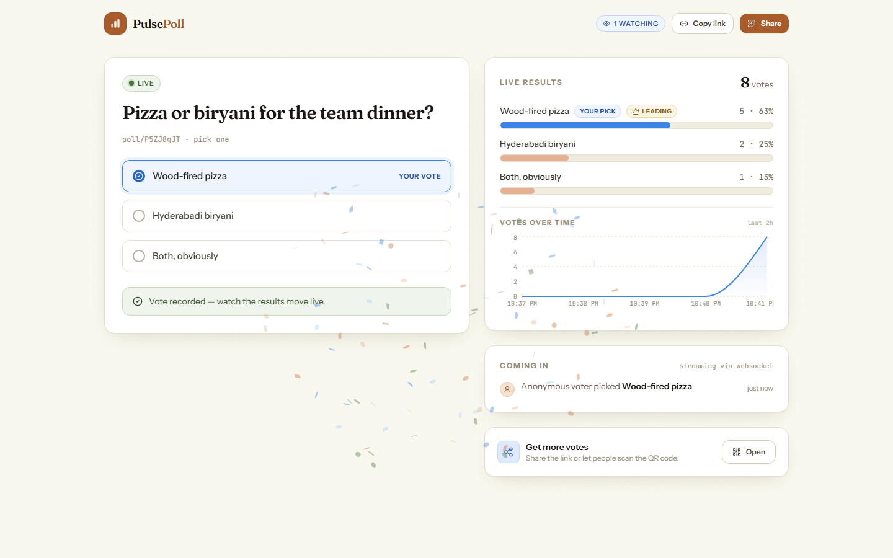

<p align="center">
  
</p>

<h1 align="center">PulsePoll - live polling for the room</h1>

<p align="center">
Create a poll → share one link → everyone watching sees results update in real time, with no refresh.
</p>

<p align="center">
  <b>React</b> · <b>Go (Gin)</b> · <b>MongoDB</b> · <b>Redis</b> · WebSockets · Playwright-tested
</p>

---

## What it is

PulsePoll is a live polling tool. A signed-up user creates a poll (2-8 options, optional
multi-select, optional auto-close timer), shares the link or QR code, and every open screen -
the audience, the creator's dashboard, a projector in the room - updates the moment a vote
lands. No refreshes, no polling the API, no manual tallying.

**Live demo:** _deployed on Vercel + Render - link will be added here on completion_

## How the real-time pipeline works

```
Voter ──POST /api/polls/slug/:slug/vote──► Go (Gin) backend
                                              │  1. validate ballot server-side
                                              │  2. insert durable Vote row (MongoDB, unique voter index)
                                              │  3. HINCRBY counters + INCR total (Redis)
                                              │  4. PUBLISH pp:events:<pollId> (Redis pub/sub)
                                              ▼
                         Redis ──pattern subscribe──► every backend instance
                                                          │
                                              WebSocket fan-out to clients
                                                          ▼
                        Creator / audience screens: animated bars move in <100ms
```

The HTTP response to the voter and the WebSocket broadcast are two paths off the same
Redis increment, so the count the voter sees and the count everyone else sees can never
disagree.

## Why Redis is load-bearing, not window dressing

| Concern | Redis usage |
| --- | --- |
| **Live counts** | `pp:counts:<pollId>` hash + `pp:total:<pollId>` counter are the read path for every results view. One pipeline round-trip per vote: `HINCRBY` per chosen option, `INCR` total, then read back the fresh snapshot to broadcast. |
| **Realtime fan-out** | Votes are published to `pp:events:<pollId>`; each backend instance pattern-subscribes and pushes events to its own WebSockets. This is what makes updates truly push-based - and it means the API scales horizontally: a vote on instance A reaches viewers on instance B. |
| **One vote per person** | `SADD pp:voted:<pollId> <voterHash>` is the fast dedupe index (the MongoDB unique index `(poll_id, voter_hash)` is the final guard, so Redis is an accelerator, not a single point of failure). |
| **Viewer presence** | `pp:viewers:<pollId>` is a sorted set scored by heartbeat time. Viewers re-score every 20s; stale entries (>60s) are pruned on read, so "12 watching" is honest even after someone slams their laptop shut. |
| **Rate limiting** | Fixed-window counters (`pp:rl:<bucket>:<ip>`) protect signup (30/15min), login (20/15min) and voting (30/min). Fail-open, because protection should degrade before the product does. |
| **Metadata cache** | Poll documents are read-through cached at `pp:meta:<slug>` (60s TTL, invalidated on close/edit/delete) so the vote hot path never touches MongoDB. |

Redis holds AOF persistence in Docker; if it's ever lost, `warmCache()` on boot rebuilds
every counter from the durable vote log, and a reconciler re-verifies every 5 minutes.

## What MongoDB stores

- **users** - bcrypt-hashed credentials, unique email index
- **polls** - question, options, settings, owner, expiry; unique slug index for share links
- **votes** - one immutable document per ballot with a unique `(poll_id, voter_hash)` index.
  This is the audit trail: every live number in Redis can be recomputed from these rows.

## Key decisions & trade-offs

- **Write-through, not write-behind.** A vote hits MongoDB first, then Redis. Write-behind
  would be faster but could silently lose ballots; at this scale, durability wins. If the
  Redis increment then fails, the vote is still safe in Mongo and the reconciler repairs
  the counters.
- **Full snapshot broadcasts, not deltas.** Each event carries the complete counts map
  (≤8 options). It costs a few bytes more but makes clients stateless and immune to
  missed/duplicated frames - a client that reconnects is correct again after one message.
- **WebSockets** over SSE/polling: the audience is a fan-in/fan-out crowd, and we already
  need the socket for presence heartbeats.
- **Anonymous voting, server-side identity.** Voters don't need accounts; the server
  fingerprints `(anonymousId from localStorage, IP, user-agent)`. Strong enough to stop
  double-taps and casual stuffing; explicitly not Fort Knox, and the README says so instead
  of pretending otherwise.
- **Short slugs** (`/p/x7Kd2mQz`) instead of ObjectIDs - shares stay human-typable.
- **JWT sessions** (7-day, HS256) with bcrypt cost 12. No refresh-token machinery - the
  brief asked for a real check, not an IAM system.
- **Rate limiter fails open.** A dead Redis must not brick voting.
- **Deliberate multi-instance design.** Nothing in the hub holds cross-instance state;
  all fan-out routes through Redis pub/sub, so `docker compose up --scale backend=3`
  works as-is.

## Tech choices

| Layer | Choice |
| --- | --- |
| Frontend | React 18, TypeScript, Vite, Tailwind CSS, canvas-confetti, qrcode.react |
| Backend | Go 1.24, Gin, gorilla/websocket, golang-jwt v5, bcrypt, validator v10 |
| Database | MongoDB 7 (users, polls, votes - durable + auditable) |
| Realtime / cache | Redis 7 (counts, pub/sub, presence, dedupe, rate limits) |
| Tests | Playwright end-to-end (real browser ↔ real backend ↔ real Redis) |

## Project structure

```
/frontend                  React + TypeScript app (Vite)
  /src/pages               Landing, auth, dashboard, create poll, live poll view
  /src/components          ResultsBars, ShareModal (QR), LiveDot, Toaster...
  /src/lib                 API client, auth context, socket hook, voter identity
  /e2e                     Playwright live-flow test suite
  /screenshots             README screenshot generator
/backend                   Go (Gin) service
  /cmd/server              wiring: config, mongo, redis, hub, router, warm-up
  /internal/handlers       auth, polls, votes, websocket endpoints
  /internal/hub            WebSocket rooms + Redis pub/sub fan-out
  /internal/cache          all Redis interactions (counts, presence, limits)
  /internal/database       MongoDB connection + indexes
  /internal/middleware     JWT auth, Redis rate limiting, CORS
  /internal/validate       every input, validated before storage
docker-compose.yml         dev: Mongo + Redis
docker-compose.prod.yml    full stack on one host (nginx proxies /api + WS)
render.yaml                one-click backend + Redis blueprint
netlify.toml               alternative frontend host (static + SPA fallback)
frontend/vercel.json       SPA rewrites for Vercel deploys
```

## Running locally

Prereqs: Docker, Go 1.24+, Node 20+.

```bash
# 1. MongoDB + Redis
docker compose up -d

# 2. Backend (http://localhost:8080)
cd backend
cp .env.example .env        # optional; dev defaults work as-is
go run ./cmd/server

# 3. Frontend (http://localhost:5173, proxies /api to :8080 including WebSockets)
cd frontend
npm install
npm run dev
```

Open two browser windows on a poll - vote in one, watch the other move.

### Tests

```bash
cd frontend
npx playwright install chromium   # once
npx playwright test
```

The suite drives real browsers against the real backend and asserts, among other things,
that **a vote cast in one browser appears in another browser with no reload**, that a
second ballot from the same voter is rejected with `409` from the API (not just hidden in
the UI), that anonymous writes to `/api/polls` get `401`, that malformed polls get `422`,
and that closing a poll flips already-open viewer tabs over the socket.

## API reference

| Method | Path | Auth | Purpose |
| --- | --- | --- | --- |
| POST | `/api/auth/signup` | - | Create account, returns JWT |
| POST | `/api/auth/login` | - | Login, returns JWT |
| GET | `/api/auth/me` | JWT | Current user |
| POST | `/api/polls` | JWT | Create poll |
| GET | `/api/polls` | JWT | Owner's polls with live totals |
| PATCH | `/api/polls/:id` | JWT | Open / close a poll |
| DELETE | `/api/polls/:id` | JWT | Delete poll + votes |
| GET | `/api/polls/:id/export.csv` | JWT | CSV results export |
| GET | `/api/polls/slug/:slug` | - | Public poll + live counts + viewers |
| POST | `/api/polls/slug/:slug/vote` | - (rate-limited) | Cast a ballot |
| GET | `/api/ws/polls/:slug` | - | WebSocket: `state`, `vote`, `presence`, `status`, `deleted` |
| GET | `/api/health` | - | Mongo + Redis health check |

## Extra features (and why they exist)

- **QR codes + WhatsApp/X share** - the whole point is getting the link into a room fast; a QR on a projector beats typing a URL.
- **Live viewer count** - hosts need to know the room is actually in before they close the poll.
- **Auto-close timers + manual open/close** - time-boxed polls for events, with the state change pushed live to open tabs.
- **Multi-select polls** - "pick all that apply" is the most common real poll, and it exercises the counter design honestly.
- **"Coming in" activity feed** - anonymized vote stream so a quiet poll still feels alive.
- **CSV export** - the brief is polling; somebody will always want the numbers in a sheet.
- **One-vote enforcement users can't bypass by clearing storage** - server-side fingerprinting.

## Deployment

**Recommended free stack** (Render + Vercel + MongoDB Atlas):

1. **MongoDB Atlas** free cluster → Database Access: create a user; Network Access: allow
   `0.0.0.0/0` (Render's free tier has no static egress IPs); copy the `mongodb+srv://` URI.
2. **Render**: New → Blueprint → point at this repo. `render.yaml` provisions the API
   (Docker) and Redis (Key Value); paste `MONGO_URI` and set `CORS_ORIGINS` when prompted.
3. **Vercel**: Add New → Project → import this repo, set **Root Directory** to `frontend`,
   add `VITE_API_URL` = your Render service URL (baked in at build time), deploy.

**Single host:** `docker compose -f docker-compose.prod.yml up -d --build` - the frontend
nginx container proxies `/api` (REST + WebSocket upgrade) to the backend, so everything
runs behind one port.

### Environment variables

| Var | Where | Purpose |
| --- | --- | --- |
| `MONGO_URI`, `MONGO_DB` | backend | MongoDB connection |
| `REDIS_URL` | backend | Redis connection |
| `JWT_SECRET` | backend | token signing (required in production) |
| `CORS_ORIGINS` | backend | comma-separated allowed browser origins |
| `VITE_API_URL` | frontend build | backend origin for static deploys |

## Security notes

- All input validated server-side (length, format, option membership, dedupe) before it
  touches MongoDB or Redis; JSON bodies capped at 64KB.
- Passwords bcrypt-hashed (cost 12); login and signup rate-limited per IP.
- Ownership checks on every mutating poll route; unknown/foreign poll ids return 404.
- Voting is rate-limited per IP and deduplicated per voter at the database level.
- The WebSocket endpoint is read-only by design: clients can send heartbeats, nothing else.
- `JWT_SECRET` is mandatory in `APP_ENV=production` (the server refuses to boot with the
  dev default).


## Documentation & Submission

- [Walkthrough Video Script & Talking Points](docs/DEMO_VIDEO_SCRIPT.md) — Includes timestamps, word-for-word lines, and direct answers to the two mandatory evaluation questions (hardest challenge & AI tools).
- [Deployment Guide](docs/DEPLOYMENT_GUIDE.md) — Step-by-step setup for Render, Vercel, and MongoDB Atlas.

---

Built by **Bontha Vijay** for the HCL GUVI developer internship task.

